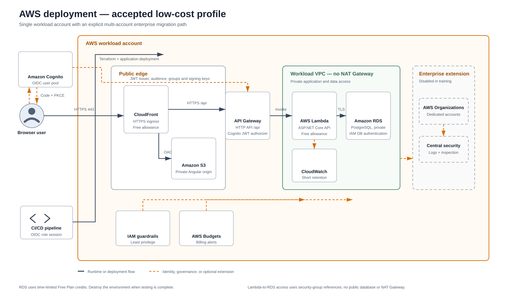

# AWS deployment architecture
Status: Implemented in Terraform; real cloud evidence pending

This is the low-cost AWS workload deployment. RDS consumption is expected to use time-limited AWS Free Plan credits where eligible and must be destroyed when the exercise is not active.

The editable SVG uses official AWS architecture icons. A [PNG rendering](diagrams/aws-deployment.png) is available for tools that do not display SVG.

## Implemented request path

1. The browser reaches one CloudFront HTTPS hostname.
2. CloudFront serves Angular from a private, encrypted, versioned S3 origin through Origin Access Control.
3. `/api/*` and `/health` are sent uncached to the API Gateway HTTP API.
4. API Gateway throttles requests and, when authentication is enabled, validates Cognito JWT issuer and audience before Lambda invocation.
5. The .NET 10 Lambda runs in two private subnets with reserved concurrency and IAM-authenticated Npgsql connections.
6. RDS PostgreSQL is encrypted, single-AZ, fixed at 20 GiB, not public, and accepts TCP 5432 only from the Lambda security group.

## Deployment and migration path

- Terraform consumes a reviewed .NET Lambda ZIP and a write-only RDS administrator password.
- A second Lambda in the same private subnets has no event source. Explicit invocation applies the reviewed EF Core migrations and provisions the `cloud_app` IAM database user.
- The migration password exists only in the invocation payload and is neither a Terraform state value nor Lambda environment variable.
- Angular is uploaded after infrastructure apply and uses `/api` as its same-origin runtime endpoint.

## Cost and operational controls

- No NAT Gateway, internet gateway, RDS Proxy, WAF, VPC endpoints, or enhanced RDS monitoring are deployed.
- Lambda concurrency and API Gateway request rates are bounded.
- RDS storage autoscaling is disabled to avoid silent expansion.
- CloudWatch logs expire after seven days by default.
- Lambda error/throttle and RDS CPU/storage alarms publish to an encrypted SNS topic.
- The monthly AWS Budget sends direct notifications when alert addresses are configured.
- Expiry, ownership, cost-centre, project, and management tags support inventory and teardown.

## Accepted limitations and extension path

- Authentication resources exist, but enforcement stays disabled until the Angular Cognito adapter and authorization tests are complete.
- Single-AZ and no retained backup are deliberate synthetic-data training trade-offs, not production recommendations.
- No WAF or Shield Advanced is included. CloudFront's default protections and throttling are the low-cost boundary.
- Enterprise extension points remain AWS Organizations, dedicated accounts, centralized logging/security, inspection, private service endpoints, multi-AZ data, backups, and automated recovery.

See [ADR-0010](../adrs/0010-host-aspnet-core-on-aws-lambda.md) and the [AWS deployment runbook](../development/deploy-aws.md).
