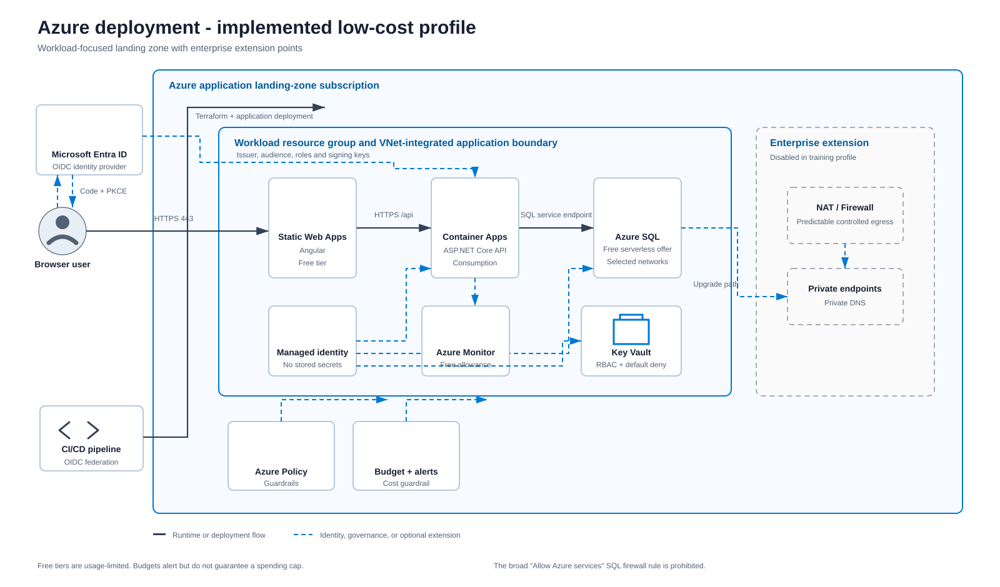

# Azure deployment architecture

Status: Implemented in Terraform; cloud deployment evidence pending

This is the low-cost Azure workload landing zone. Resource creation remains disabled until `deploy_workload = true` is explicitly reviewed and approved.

The editable SVG uses official Microsoft Azure architecture icons. A [PNG rendering](diagrams/azure-deployment.png) is also available for tools that do not display SVG.

## Implemented topology

- Azure Static Web Apps Free hosts the Angular application.
- Azure Container Apps runs the ASP.NET Core API on the Consumption workload profile with zero minimum and one maximum replica.
- The Container Apps environment is integrated with a dedicated delegated subnet.
- The subnet enables `Microsoft.Sql` and `Microsoft.KeyVault` service endpoints.
- Azure SQL authorizes the subnet with a virtual-network rule; no permanent client-IP firewall rule is created.
- Azure SQL uses the monthly free limit and auto-pauses for the remainder of the month when that limit is exhausted.
- The API uses a user-assigned managed identity and a passwordless Microsoft.Data.SqlClient connection string.
- Key Vault is RBAC-enabled and default-deny. It is an extension point; the runtime database connection does not require a stored secret.
- Log Analytics has a small daily cap. A resource-group deletion alert, action group, and monthly budget provide operational and cost signals.

## Trust and traffic decisions

- Only HTTPS application ingress is exposed to browser users.
- The browser authentication configuration reserves Microsoft Entra ID Authorization Code with PKCE. Authentication stays disabled until the Entra application-registration slice is completed.
- The API validates the configured Entra issuer, audience, signature, expiry, and roles when authentication is enabled.
- Azure SQL is never directly reachable from the browser.
- Container Apps reaches Azure SQL through the VNet service endpoint and an explicit SQL virtual-network rule.
- The broad `Allow Azure services and resources to access this server` firewall rule is prohibited.
- A migration runner may add one temporary client-IP rule; the migration script removes it in guaranteed cleanup.
- Private Link, private DNS, NAT Gateway, and Azure Firewall remain disabled enterprise extensions because they add cost.
- The deployment identity uses short-lived federation in the target delivery design rather than stored Azure credentials.

## Deployment boundary

Terraform can validate locally without cloud credentials after provider initialization. A real plan and apply require an Azure subscription, backend configuration, an immutable container image digest, expiry metadata, a budget start date, and a bootstrap-only SQL administrator password. Applying database migrations and provisioning the runtime Entra database user is a separate step.

See the [Azure deployment runbook](../development/deploy-azure.md), [ADR-0009](../adrs/0009-azure-sql-service-endpoint.md), and [implementation status](../development/implementation-status.md).
