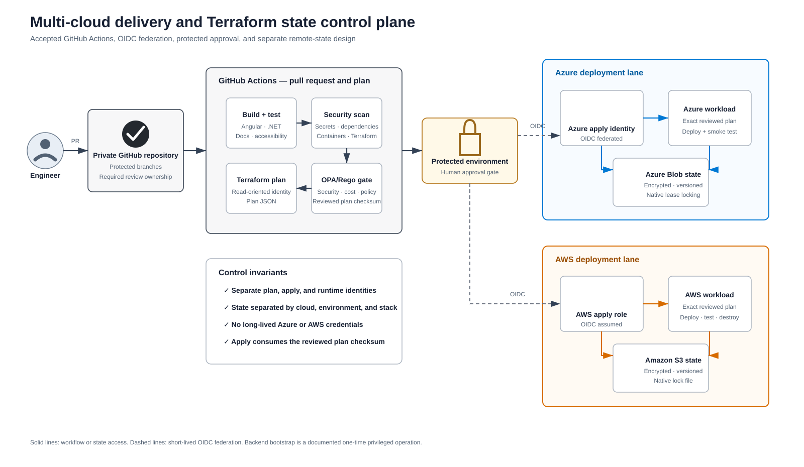

# Delivery and Terraform state control plane

- Status: Azure lane implemented; AWS lane accepted target
- Decisions: [ADR-0006](../adrs/0006-terraform-remote-state.md) and [ADR-0007](../adrs/0007-github-actions-oidc-delivery.md)

A [PNG rendering](diagrams/delivery-control-plane.png) is available for tools that do not display SVG.

## Key controls

- A private GitHub repository is the reviewed source of application, infrastructure, policy, and documentation changes.
- Pull requests run documentation, build, test, security, Terraform, and OPA/Rego checks.
- Azure and AWS each have separate read-oriented plan and privileged apply identities.
- GitHub obtains short-lived cloud identity through OIDC; long-lived cloud credentials are prohibited.
- Azure uses separate `azure-training-plan` and `azure-training` approvals; the first protects the exact plan and SQL bootstrap secret, and the second protects apply/destroy permission.
- Apply consumes the exact reviewed plan and verifies its checksum.
- Azure deploy continues through SQL migration, Angular publication, API/database/frontend smoke tests, and revocation of the temporary Static Web Apps token.
- Azure Blob Storage and Amazon S3 hold separate encrypted, versioned, locked state.
- CI concurrency is serialized per cloud, environment, stack, and state key.
- Runtime identities cannot deploy infrastructure or read Terraform state.

## Bootstrap boundary

The remote backends and OIDC trust relationships require a documented one-time privileged bootstrap. The Azure bootstrap is implemented and retains the empty workload resource group so plan/apply roles stay resource-group-scoped. See the [Azure CI/CD runbook](../development/azure-cicd.md).
