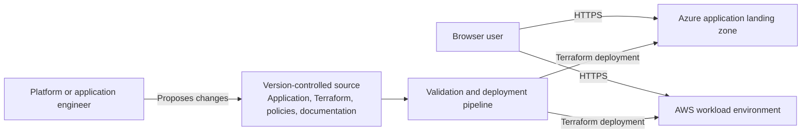
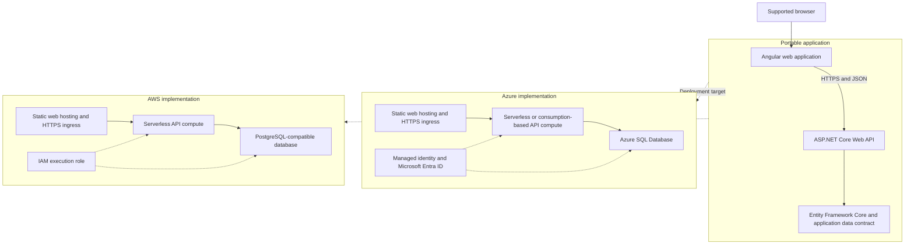
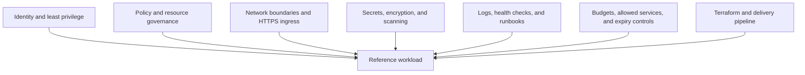

# Architecture overview

Status: Proposed

These diagrams describe intent. Exact service selections can change through Architecture Decision Records before implementation.

## System context

## Portable workload and cloud-specific infrastructure

## Landing-zone capabilities

The initial implementation contains only capabilities required by the reference workload. Each capability is exposed through a documented module boundary so that enterprise implementations can add shared networking, centralized logging, additional accounts or subscriptions, and advanced security services later.

## Delivery and policy enforcement

```mermaid
flowchart LR
    change["Application, infrastructure, policy, or documentation change"]
    static["Format, lint, unit test, secret scan"]
    plan["Terraform plan"]
    planjson["Terraform plan JSON"]
    opa["OPA/Rego policy evaluation"]
    approval["Human review and approval"]
    apply["Terraform apply"]
    native["Azure Policy or AWS guardrails"]
    smoke["Application and security smoke tests"]

    change --> static --> plan --> planjson --> opa
    opa -->|"Allowed"| approval --> apply --> native --> smoke
    opa -->|"Denied with reasons"| change
```

## Well-Architected mapping

| Pillar | Initial evidence |
|---|---|
| Reliability | Health endpoints, repeatable deployments, smoke tests, documented recovery and destruction |
| Security | Least privilege, short-lived identity, encrypted transport, protected databases, policy gates |
| Cost Optimization | Small approved services, budgets, expiry tags, expensive-resource deny policies |
| Operational Excellence | IaC, CI checks, ADRs, runbooks, observable deployment and application behavior |
| Performance Efficiency | Serverless or consumption-based scaling, browser and API performance tests |

## Known training trade-offs

Private endpoints, enterprise firewalls, multi-region redundancy, centralized security operations, and long-term log retention can create material charges. They will be documented as extension modules rather than enabled in the zero-cost profile.
