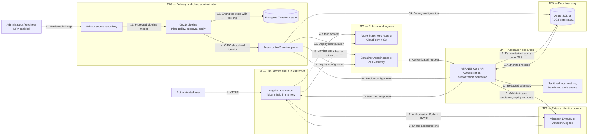

# Security data-flow diagram

- Status: Implemented locally; Azure and AWS sign-in evidence pending
- Scope: Local, Azure training, and AWS training workload variants

This logical diagram is intentionally provider-neutral. The [Azure deployment](azure-deployment.md) and [AWS deployment](aws-deployment.md) diagrams provide the cloud-specific topology.

## Trust boundaries

| Boundary | Main concern | Required control |
|---|---|---|
| TB1 | Untrusted browser, malicious input, stolen token | PKCE, CSP, validation, no local-storage tokens, HTTPS |
| TB2 | Incorrect identity-provider or token configuration | Exact issuer/audience validation, state, nonce, short token lifetime |
| TB3 | Internet exposure and cost-exhaustion traffic | HTTPS, restrictive CORS, throttling, quotas, security headers |
| TB4 | Authorization bypass, injection, secret leakage | Policy-based authorization, ownership checks, parameterized access, redaction |
| TB5 | Database exposure, data loss, excessive privilege | Private/restricted networking, TLS, least privilege, encryption, reseed/restore procedure |
| TB6 | Supply-chain compromise and excessive deployment privilege | Protected review, signed/verified dependencies where practical, OIDC, separate plan/apply roles, policy gates |

## Assets

- Identity tokens, role claims, and authentication configuration.
- Synthetic interview data and ownership identifiers.
- Database credentials where token-based access is unavailable.
- Terraform state, which can contain sensitive infrastructure metadata.
- Source code, build dependencies, container images, and deployment artifacts.
- Pipeline identities and cloud role assignments.
- Security policies, approvals, logs, and audit evidence.
