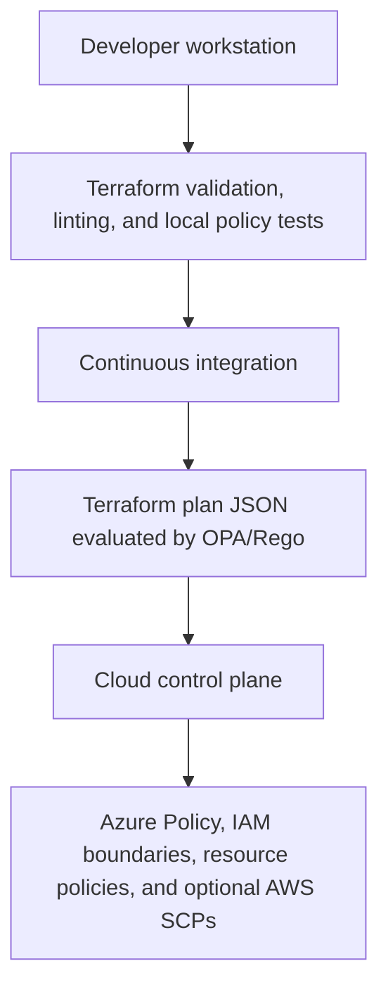

# Policy-as-Code design

Status: Implemented baseline

## Objectives

- Prevent unsafe or unexpectedly expensive Terraform changes before deployment.
- Express common intent consistently across Azure and AWS.
- Retain provider-specific controls where cloud behavior differs.
- test policies with allowed and denied examples.
- Enforce critical controls against changes made outside Terraform where practical.

## Enforcement layers

## Policy groups

- Common policies: required metadata, encryption, prohibited public exposure, TLS, secrets, approved capacity, and expiry controls.
- Azure policies: allowed regions and SKUs, protected Azure SQL and Storage, managed identity, and Azure Policy assignments.
- AWS policies: allowed regions and services, protected S3 and PostgreSQL resources, least-privilege IAM, and optional organization SCPs.

## Enforcement levels

- `deny`: clear security or cost hazards that must block deployment.
- `warn`: accepted training trade-offs or controls that require context.
- `document`: enterprise controls intentionally omitted from the low-cost profile.

Exceptions must be narrow, time-bound, owned, justified, and reviewed. An exception is stored as code and must include an expiry date.

## Initial deny policies

- Block unrestricted access to database and administrative ports.
- Block public databases and anonymous object storage.
- Block unapproved regions, services, SKUs, and instance sizes.
- Block expensive network appliances in the training profile.
- Block wildcard administrative IAM permissions unless an approved exception exists.
- Require HTTPS and encryption at rest.
- Require ownership, environment, project, management, cost, and expiry metadata.
- Block sensitive Terraform outputs.

The implemented AWS training rules additionally deny NAT Gateway, RDS Proxy, Network Firewall, public or unencrypted RDS, disabled IAM database authentication, unapproved RDS classes, Multi-AZ and storage autoscaling in the low-cost profile, PostgreSQL CIDR ingress, Lambda concurrency above five, and a non-HTTPS CloudFront default behavior.

## Testing

Each rule has at least one compliant fixture and one non-compliant fixture. Policy tests run locally and in continuous integration. A policy change cannot be merged unless its tests and documentation are updated.
